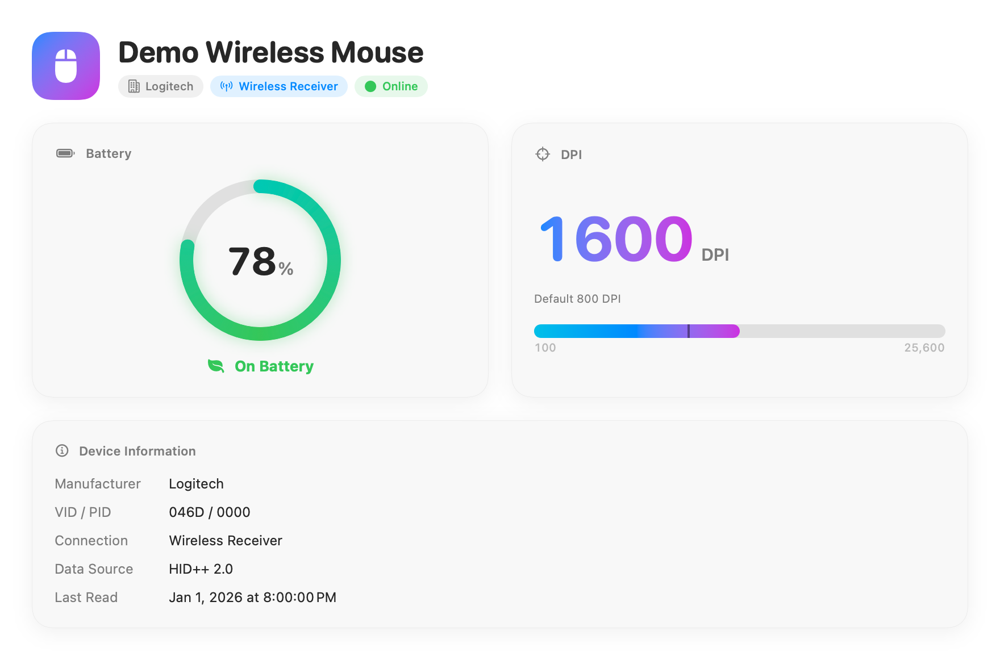
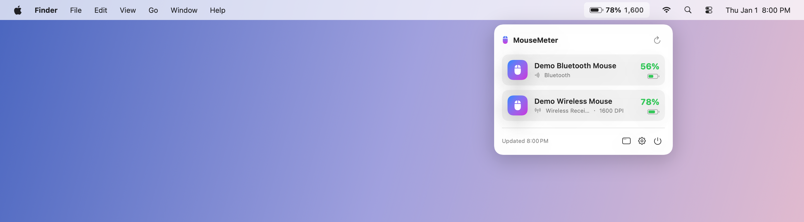

# MouseMeter

A macOS menu bar app built with Swift and SwiftUI for monitoring mouse battery levels and DPI. Supports battery monitoring for compatible mice across brands, including Logitech HID++ mice and other mice whose battery information is available through macOS. DPI monitoring is available for supported Logitech HID++ devices. The interface supports English, Simplified Chinese, and Japanese.

[简体中文](docs/README.zh-CN.md)



*The image uses synthetic demo data.*

## Device compatibility

MouseMeter supports compatible mice from multiple brands through two data sources:

| Data source | Compatible devices | Battery | DPI |
| --- | --- | --- | --- |
| Logitech HID++ | Compatible Logitech mice connected via a receiver, USB, or Bluetooth | When exposed by the device | When exposed by the device |
| macOS battery information | Magic Mouse and other brands’ mice whose battery level is exposed through macOS IORegistry (`BatteryPercent`), including compatible Bluetooth mice | When available through macOS | Not supported |

Other brands do not need to use Logitech HID++ for battery monitoring: MouseMeter reads the battery information provided by macOS. HID++ is a Logitech-specific protocol, and the current DPI implementation uses it. Compatibility depends on the model, connection method, and data exposed by macOS; support for one device does not guarantee support for every model from that brand.

## Menu bar



*Rendered illustration with sample data, a simulated macOS menu bar, and the actual MouseMeter panel. Battery percentage and DPI are both enabled here.*

The menu bar shows a battery icon and, by default, the battery percentage. In Settings, you can choose which mouse to display and toggle the percentage and DPI display.

Click the menu bar icon to see device battery levels, connection status, and available DPI readings. Click a device to open its details. The panel also provides buttons to refresh readings, open the main window or Settings, and quit. Closing the main window keeps MouseMeter running in the menu bar.

## Build and package

Requires macOS 15 or later and Xcode 16 or later with Swift 6. Run from the project root:

```bash
make dmg      # Build the app and DMG (default target)
make app      # Build build/MouseMeter.app only
make install  # Build and install to /Applications
make clean    # Remove packaging output
```

Builds support both Apple silicon and Intel Macs by default. The version is read from `VERSION`, and the DMG is saved to `build/MouseMeter-<version>.dmg`. Open the DMG and drag MouseMeter into Applications to install it.

## Code signing

The app and DMG currently use the self-signed certificate `Flick Self-Signed Code Signing` and are not notarized by Apple. macOS may block the app on first launch.

The default build requires this certificate and its private key in your local keychain. To build with your own signing identity:

```bash
make dmg SIGN_IDENTITY="Your Code Signing Identity"
```

For a local ad hoc signed build:

```bash
make dmg SIGN_IDENTITY=-
```

## License

[MIT](LICENSE) © 2026 zhy2006.
