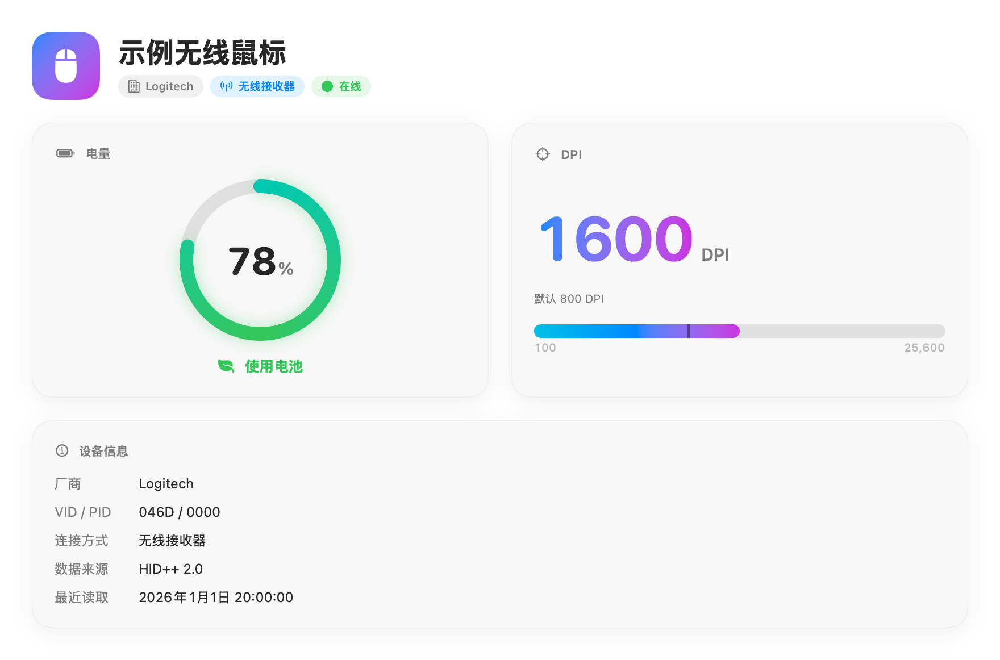

# MouseMeter

使用 Swift 和 SwiftUI 构建的 macOS 菜单栏工具，用于查看鼠标电量和 DPI。支持兼容的罗技 HID++ 鼠标，以及提供电量信息的蓝牙鼠标，界面支持简体中文、英文和日文。

[English](../README.md)



*图中使用虚构的演示数据。*

## 构建与打包

需要 macOS 15 或更高版本，以及带有 Swift 6 工具链的 Xcode 16 或更高版本。在项目根目录执行：

```bash
make dmg      # 构建 App 并生成 DMG（默认目标）
make app      # 仅生成 build/MouseMeter.app
make install  # 构建并安装到 /Applications
make clean    # 清理打包产物
```

默认构建同时支持 Apple 芯片和 Intel Mac 的通用版本。版本号读取自 `VERSION`，安装包输出到 `build/MouseMeter-<版本号>.dmg`。打开 DMG 后，将 MouseMeter 拖入 Applications 即可安装。

## 签名说明

目前 App 和 DMG 使用自签名证书 `Flick Self-Signed Code Signing`，未经过 Apple 公证。首次打开时，macOS 可能会拦截应用。

默认构建需要本机钥匙串中存在该证书及其私钥。如需使用自己的签名身份：

```bash
make dmg SIGN_IDENTITY="你的代码签名身份"
```

仅供本地使用时，也可以采用临时签名（ad hoc）构建：

```bash
make dmg SIGN_IDENTITY=-
```

## 许可证

[MIT](../LICENSE) © 2026 zhy2006。
